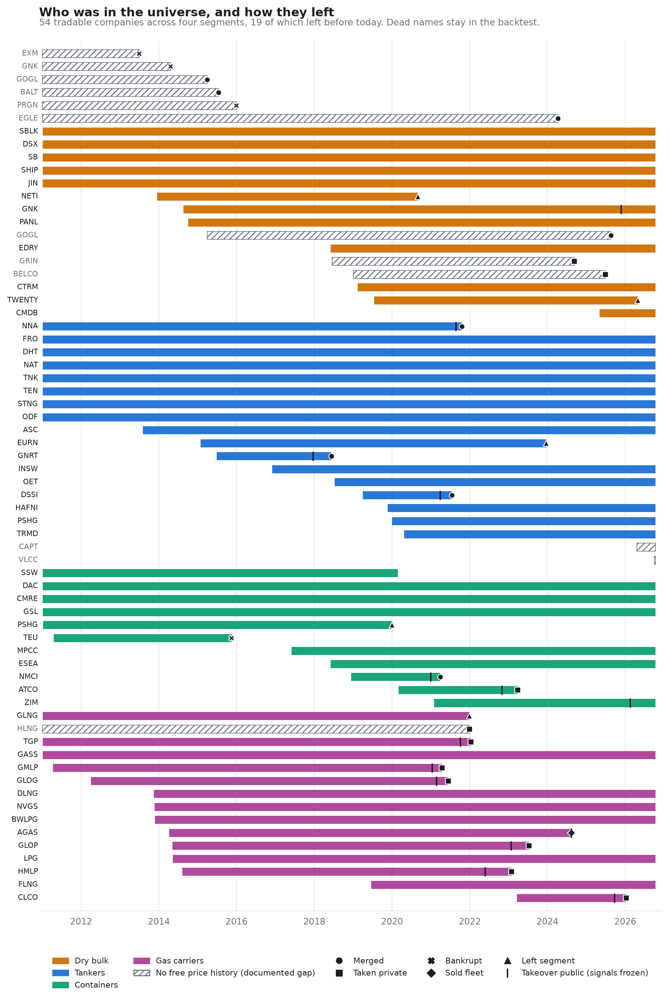

# 01 · Data foundation

**Question.** Can free data support an honest backtest of listed shipping equities?

**Answer.** Yes, but only after fixing errors that would otherwise manufacture results. This
project builds a point-in-time universe of 73 New York- and Oslo-listed shipping companies
(2011-2026), keeps the dead ones, and documents every gap.

| What was found | What it would have done | Fix |
|---|---|---|
| Bad USD/NOK print in Yahoo (7.74 vs official 11.68, 20 Mar 2020) | +45% then -35% day in every Oslo stock | FX from the Federal Reserve (FRED) |
| Vendor adjusted close missed a NOK 131 liquidating distribution | 2020 Bulkers shows -96% instead of about +3% | Total returns rebuilt from prices + cash distributions |
| Four dead tickers recycled by ETFs (BALT, EGLE, GOGL, GRIN) | Wrong company silently spliced in | Identity pinned in the register; documented gaps |
| Zero-volume days quoted at stale prices | Fake 0% returns, then fake jumps | No trade, no return |
| Takeover targets trade on deal terms | Merger-arbitrage noise in signals | Signals frozen from first public bid (ZIM, Genco today) |

**Survivorship cuts both ways in shipping.** Most exits were takeovers at a premium, and the
bankruptcies are precisely the names without free history, so the measurable bias is small for
the wrong reason. Stated as a limitation, not corrected away.

| | |
|---|---|
| Register | [`data/reference/universe.csv`](../data/reference/universe.csv): 73 companies, segment windows, exit type, deal dates, gaps |
| Notebook | [`notebooks/universe_and_data_audit.ipynb`](notebooks/universe_and_data_audit.ipynb) |
| Code | [`src/shiplab/universe.py`](../src/shiplab/universe.py), [`prices.py`](../src/shiplab/prices.py), [`panel.py`](../src/shiplab/panel.py), [`qa.py`](../src/shiplab/qa.py) |
| Sources | [`docs/DATA.md`](../docs/DATA.md) |

**Next:** [02 · Freight priced by Friday →](../02-freight-priced-by-friday)
