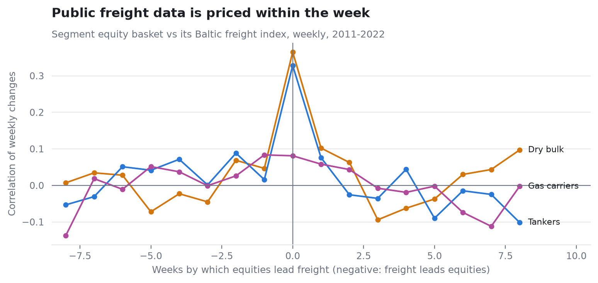
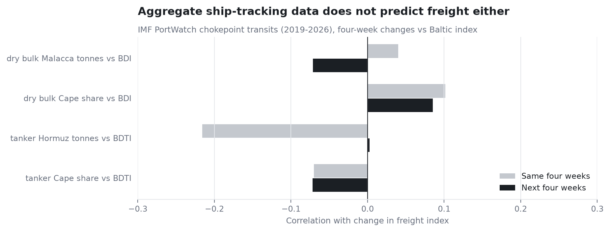

# 02 · Freight priced by Friday

**Question.** Do public freight indices, or freely available ship-tracking data, predict
shipping stock returns?

**Answer.** No. Equity baskets and their Baltic freight indices move together in the same
week, and neither freight nor aggregate AIS data predicts the next month. The market prices
public freight information fast.

| Test (weekly, 2011-2022 unless stated) | Same period | Next four weeks |
|---|---|---|
| Dry bulk basket vs Baltic Dry Index | 0.37 | -0.05 (freight -> equity) |
| Tanker basket vs Baltic Dirty Tanker Index | 0.33 | 0.18 (freight -> equity) |
| PortWatch chokepoint flows vs freight (2019-2026, four tests) | up to -0.22 | all below 0.09 |

**Why it matters.** Freight momentum or freight timing should not be expected to earn a return
after costs, and indeed did not (project 03). If an information edge exists, it must come from
something the market sees late: what each company's own ships are doing (project 04).

| | |
|---|---|
| Notebook | [`notebooks/freight_vs_equities.ipynb`](notebooks/freight_vs_equities.ipynb): fifteen years of freight and equities, within-segment dispersion, lead-lag, PortWatch |
| Data | Baltic indices daily since 2006; IMF PortWatch transits since 2019 |
| Code | [`src/shiplab/freight.py`](../src/shiplab/freight.py), [`portwatch.py`](../src/shiplab/portwatch.py) |

**Previous:** [← 01 · Data foundation](../01-data-foundation) · **Next:** [03 · Market-neutral long/short →](../03-market-neutral-long-short)
