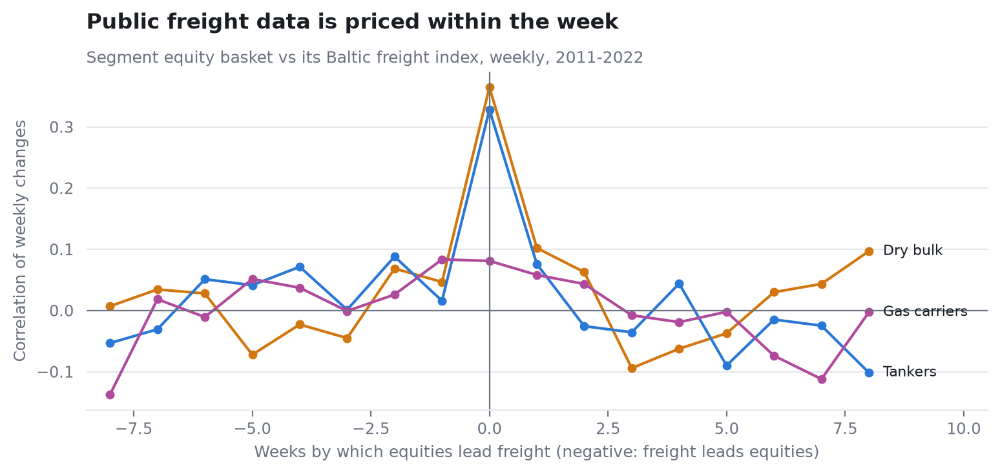

# Freight Priced by Friday

*Linked research component · Prepared 5 November 2026*

## The research question

Do freight indices or aggregate AIS predict shipping equity returns?

## Approach

Lead-lag comparisons and rolling ridge nowcasts compare public freight and port information against simple baselines.

The practical result is a constraint on the research agenda: a contemporaneous relationship does not by itself supply a tradeable lead.

## Evidence and result

Same-week basket/index correlations are 0.37 in dry bulk and 0.33 in tankers. Adding port/equity features worsens the documented freight nowcast.

*Weekly relationships; see notebook for dates and specification.*

## Scope and limitations

A null in these models is not proof of universal market efficiency. Frequency, sample choice and repeated specification searches matter.

## Explore the project

Open freight_vs_equities.ipynb and freight_nowcast.ipynb.

## Sources and evidence

[README.md](../README.md)

---

Hrush Ambekar · Research snapshot reviewed 5 November 2026. See linked source files for full methodology, figures and reproducibility.
