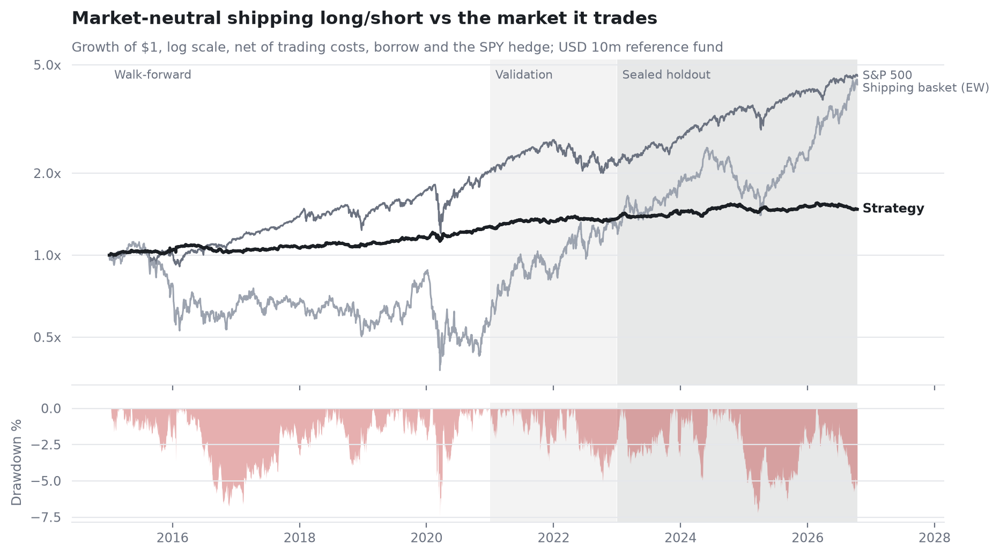

# Shipping Market-Neutral Selection

*Linked research component · Prepared 5 November 2026*

## The research question

Is public-data stock-selection alpha distinguishable from luck?

## Approach

Within-segment value and residual signals feed a hedged portfolio with costs, borrow, capacity stresses, yearly selection and a logged 27-trial search.

The trial log, holdout and cost assumptions let a reader distinguish market neutrality and weak historical performance from evidence of skill.

## Evidence and result

Reported 2023-October 2026 holdout Sharpe is 0.42, return 2.1% per year, drawdown -7.2%, beta -0.01; deflated-Sharpe probability is 0.31.

*Historical backtest; see notebook for dates and cost assumptions.*

## Scope and limitations

The search-adjusted result does not establish skill. Capacity is assumption-dependent; retrospective pre-registration needs chronology scrutiny.

## Explore the project

Inspect the summary notebook, trial log and preregistration before rerunning the holdout.

## Sources and evidence

[README.md](../README.md)

---

Hrush Ambekar · Research snapshot reviewed 5 November 2026. See linked source files for full methodology, figures and reproducibility.
