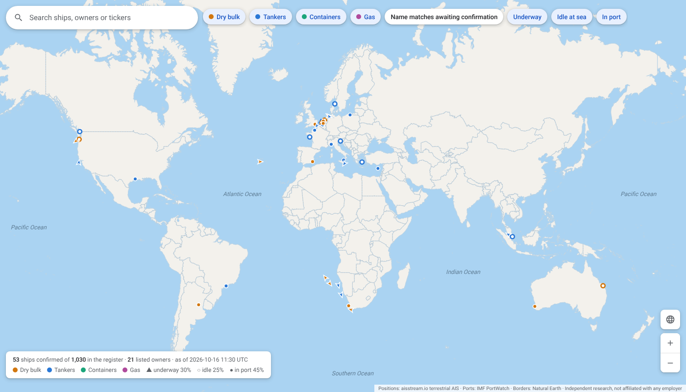
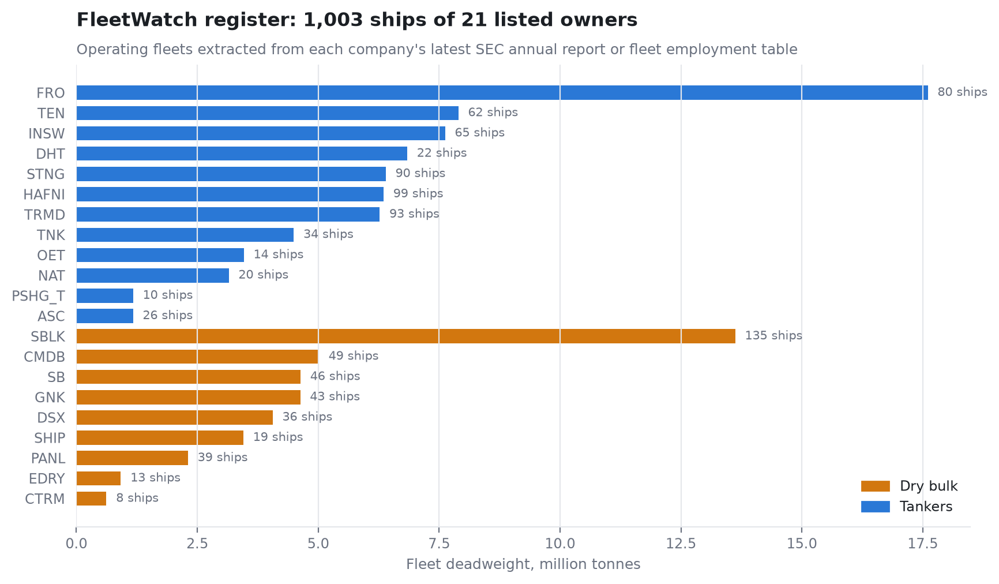

# 04 · FleetWatch

**Question.** Can ship-level tracking of each listed owner's fleet see what the market prices
late: utilisation, idle time, geography?

**What exists today.** A register of about 1,000 operating ships mapped to 21 listed dry bulk
and tanker owners, extracted from the companies' own SEC filings (with charter terms where
disclosed), and an AIS collector that records them every hour into this repository. Every
estimate is committed before the company reports, so the live record cannot be fitted after
the fact.

**[Open the live map →](https://ambekarhrush.github.io/shipping-long-short-lab/fleetwatch/)**
You can search any ship, owner or ticker, filter by segment and by state (underway, idle at
sea, in port), and open a ship's card for its class, deadweight, nearest port, destination and
last position. Each card links to the same spot in Google Maps and Google Earth.
[`fleetwatch.kml`](../docs/fleetwatch/fleetwatch.kml) imports the whole fleet into
[Google My Maps](https://www.google.com/maps/d/) (Create a new map → Import).

**Why this, and not raw AIS.** Large funds buy global AIS. What is not sold as a package is the
mapping from ships to small, thinly covered listed owners, and a model of each owner's quarter.
Project 02 shows aggregate AIS adds nothing; the information is in the attribution.

| Layer | Source | Status |
|---|---|---|
| Fleet register | SEC 20-F / 10-K fleet tables, Diana fleet employment 6-K, company fleet pages | ~1,000 ships, 21 owners |
| AIS identity (MMSI/IMO) | aisstream.io static reports, matched by name, type and hull length | building, hourly |
| Ship state: underway / waiting / alongside, laden / ballast, region | AIS positions and draught, PortWatch ports | building, hourly |
| Company signals: idle share, regional exposure | aggregation by deadweight | forward from October 2026 |
| Historical test, US waters 2016-2024 | NOAA AIS, point-in-time fleets from every annual report since 2014 | pre-registered, run once: **null** (IC -0.02, t -0.7) |
| Map | `scripts/fleet_snapshot.py` + `scripts/build_fleet_map.py` | live; ships appear once their own static report confirms identity |

**History test result.** The single pre-registered hypothesis was that owners with more idle
ships underperform their segment the next month. Over 102 months it found nothing. As the
pre-registration said in advance, US waters see each fleet only near American ports, so this
does not reject the global design. It does mean idle share has no historical support yet.
(NOAA has not published 2025, and half of its 2024 files return errors, so coverage ends in
2024 with gaps.)

**The 2026 Hormuz test case.** When the strait closed on 28 February 2026, more than 150
tankers waited outside it. Which owners had ships trapped in the Gulf, and which were positioned
to gain from Cape routing, mattered more to their quarter than any index. That is exactly the
exposure FleetWatch measures.

**First scored season:** Q4 2026 results (February 2027).

| | |
|---|---|
| Notebooks | [`notebooks/fleetwatch.ipynb`](notebooks/fleetwatch.ipynb) · [`notebooks/fleet_map_and_history_test.ipynb`](notebooks/fleet_map_and_history_test.ipynb) |
| Register | [`data/reference/fleet_register.csv`](../data/reference/fleet_register.csv) |
| Live data | [`data/fleet/`](../data/fleet) (written by the hourly workflow) |
| Code | [`src/shiplab/fleet/`](../src/shiplab/fleet), [`.github/workflows/fleetwatch.yml`](../.github/workflows/fleetwatch.yml) |
| Pre-registration (history test) | [`docs/PREREGISTRATION_FLEET_HISTORY.md`](../docs/PREREGISTRATION_FLEET_HISTORY.md) |

**Previous:** [← 03 · Market-neutral long/short](../03-market-neutral-long-short) · **Next:** [05 · Filings analyser →](../05-filings-analyser)
