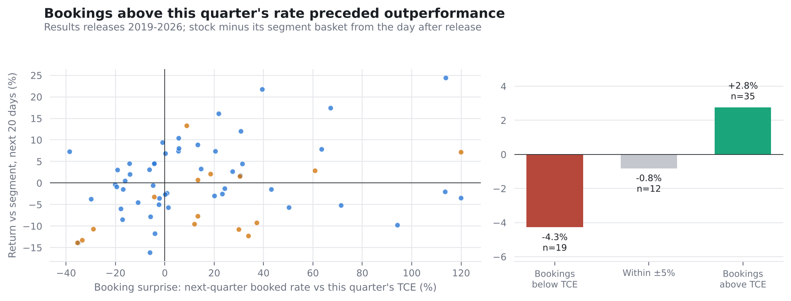
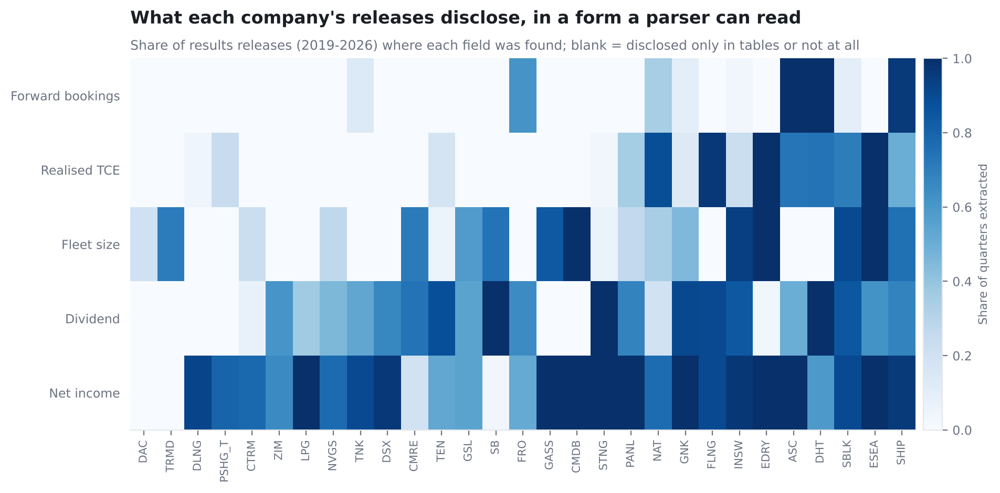

# 05 · Filings analyser

**Question.** What do shipping companies tell the market in their results releases, quarter by
quarter, and does the market read it?

**Answer.** Partly. The analyser parses every results release that the live universe has filed
with the SEC since 2019: 758 releases from 29 companies, HTML and PDF. When a company's
next-quarter bookings run above the rate it just earned, its stock beat its segment by about
3% over the following month. When they run below, it lagged by about 4%. The rank correlation
is 0.26 (t 2.2) over 66 releases. The sample is small and mostly tankers, and the test was
specified before returns were computed but not committed in advance. It is a lead, now
[pre-registered](../docs/PREREGISTRATION_FILINGS.md) for a live test from the Q3 2026 season.

**What it extracts.** Each number keeps the sentence it came from (`*_src` columns), so any
figure can be checked against the filing.

| Field | Example sentence | Releases where found |
|---|---|---|
| Next-quarter bookings (share of days, rate) | "approximately 71% of the Company fleet's expected operating days in the third quarter ... fixed at an estimated TCE of approximately $30,112" | 16% |
| Realised TCE | "achieved average combined time charter equivalent earnings of $126,700 per day" | 28% |
| Fleet size | "a fleet of 138 vessels" | 37% |
| Dividend per share | "dividend of $0.90 per common share" | 55% |
| Net income | "net income of $144.9 million" | 77% |

**Quarter-on-quarter flags.** These are the first things an analyst checks on results day:
- bookings far above or below the quarter just reported
- dividend raised or cut
- fleet growth or sales
- coverage jumping by 15 points or more

They are in [`data/results/filings_extracted.csv`](../data/results/filings_extracted.csv).

**Limits.** The parser reads sentences, not tables. Scorpio Tankers, for example, moved its
booking guidance into a table in 2024, and Danaos discloses contract backlog in a form this
version does not read. Extraction uses deterministic patterns, with no model calls, so every
number can be reproduced from the saved text.

| | |
|---|---|
| Notebook | [`notebooks/filings_analyser.ipynb`](notebooks/filings_analyser.ipynb) |
| Run | `python scripts/pull_filings.py` then `python scripts/run_filings.py` |
| Code | [`src/shiplab/filings.py`](../src/shiplab/filings.py) |
| Releases (text) | `data/filings/releases/<company>/` |

**Previous:** [← 04 · FleetWatch](../04-fleetwatch)
