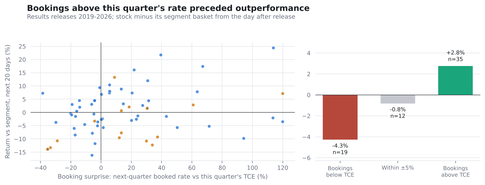

# Shipping Filings Analyser

*Linked research component · Prepared 5 November 2026*

## The research question

Do bookings disclosures contain information equities absorb slowly?

## Approach

Deterministic patterns extract values with source sentences from HTML/PDF releases, flag quarterly changes and compare booking surprise with later relative returns.

Each extracted figure retains its source sentence, supporting a manual check of both the number and its context in the release.

## Evidence and result

The repository reports 758 releases from 29 issuers. Booking-surprise rank IC is 0.26 with t=2.2 across 66 events; next-quarter bookings are extracted from only 16% of releases.

*Exploratory sample; not pre-registered before initial analysis.*

## Scope and limitations

Small, tanker-heavy sample; the initial test was not committed before analysis. Sentence parsing misses tables and changing disclosure formats.

## Explore the project

Inspect filings_extracted.csv, its source columns and the live-test preregistration.

## Sources and evidence

[README.md](../README.md)

---

Hrush Ambekar · Research snapshot reviewed 5 November 2026. See linked source files for full methodology, figures and reproducibility.
