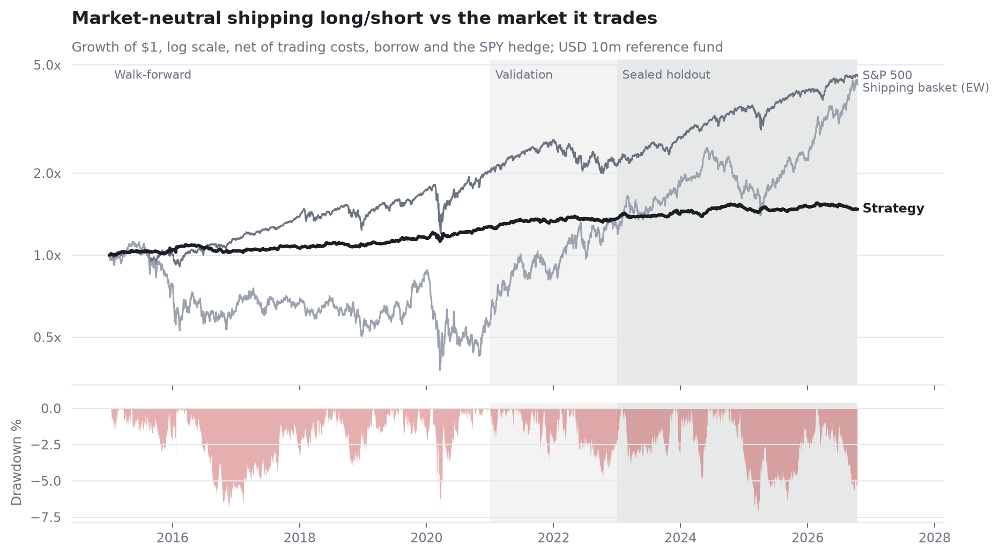

# Shipping long/short research lab

**Where does an edge in listed shipping actually come from? Fifteen years of evidence, a sealed
holdout, and a live ship-tracking record that starts now.**

Market-neutral stock selection in 54 New York- and Oslo-listed shipping companies (dry bulk,
tankers, containers, gas), 2011-2026, with dead and merged companies kept in. Built to answer one
question honestly: is there return from *stock selection* that is not just freight rates or the
market in disguise?



| Period (USD 10m reference fund, net of costs) | Sharpe | Return p.a. | Vol | Max DD | Beta |
|---|---|---|---|---|---|
| Walk-forward 2014-2020 | 0.70 | 3.6% | 5.2% | -7.5% | 0.03 |
| Validation 2021-2022 | 0.61 | 3.3% | 5.5% | -5.1% | 0.01 |
| **Sealed holdout 2023 - Oct 2026** (pre-registered, run once) | **0.42** | 2.1% | 5.3% | -7.2% | -0.01 |

**What we found**

1. **Public freight data is priced within the week.** Equities and Baltic indices move together;
   freight does not predict next month's dry bulk returns. Freight timing adds nothing.
2. **Cheapness within a segment, and fading moves out of line with a stock's freight
   sensitivity, earn a small, genuinely market-neutral return** (holdout beta -0.01; positive in
   the 2016 trough and the Red Sea disruption; -5% in the 2026 Hormuz crisis).
3. **Capacity is the binding constraint:** Sharpe 0.6-0.8 up to USD 25m; dollar alpha plateaus
   below USD 1m a year.
4. **After correcting for 27 logged trials, the public-data edge is not statistically
   distinguishable from luck** (deflated-Sharpe probability 0.31).

So the edge, if there is one, must come from company-specific information that reaches the
market late. That is **FleetWatch**: ~1,000 named ships of 21 listed owners, mapped from their
own SEC filings and tracked hourly by AIS, with every estimate committed here before the
companies report.

[Research paper (PDF)](paper/shipping_long_short.pdf) ·
[Two-page note](paper/research_note.pdf) ·
[Executive summary notebook](notebooks/00_executive_summary.ipynb) ·
[Pre-registration](docs/PREREGISTRATION.md) ·
[Every trial run](data/results/trials.csv)

## Two tracks, one data layer

| | Backtest track | FleetWatch track |
|---|---|---|
| Question | Does public information earn stock-selection alpha? | Does ship-level operating information the market sees late? |
| Data | Prices (Yahoo, Tiingo), SEC XBRL fundamentals, Baltic indices, IMF PortWatch | Fleet register from SEC filings, AIS (aisstream.io), PortWatch ports |
| Period | 2011-2026, walk-forward + sealed holdout | Forward from October 2026, committed hourly |
| Status | Complete (this release) | Collecting; scored against each earnings season |

## Method in one screen

* **Universe:** point-in-time register of 73 companies; 54 tradable with free data; 19
  exclusions and survivorship gaps documented in [`data/reference/universe.csv`](data/reference/universe.csv).
* **Data hygiene:** total returns rebuilt from prices and cash distributions (vendor adjusted
  closes missed a NOK 131 liquidating distribution); FX from the Federal Reserve (a bad Yahoo
  NOK print would have faked a +45% day in every Oslo stock); recycled tickers detected.
* **Sleeves:** within-segment pairs; factor ranks (value, balance-sheet strength, freight-beta
  momentum); equity-vs-freight residual fade. All segment-neutral.
* **Portfolio:** 6% vol per sleeve, name/gross/liquidity caps (10% of daily value), SPY beta
  hedge, drawdown brake, one-day trading lag, spreads + impact + borrow by liquidity tier.
* **Validation:** walk-forward parameter choice, every variant logged automatically, holdout
  sealed in code and pre-registered in git, deflated Sharpe ratio.

## Run it

```bash
uv sync --frozen --extra dev
echo "TIINGO_API_KEY=..." > .env           # free key; needed for delisted US names
# freight history: data/manual/baltic_indices_barchart_*.csv (see docs/DATA.md)
uv run python scripts/pull_prices.py
uv run python scripts/run_research.py --holdout
uv run python scripts/build_notebooks.py
uv run pytest -q
```

## Limitations

The investable universe is small and illiquid; vessel values are not available point-in-time
for free, so book value stands in for NAV; borrow costs are modelled, not observed; four
merged companies (Baltic Trading, Eagle Bulk, Golden Ocean, Grindrod) and several bankruptcies
lack free price history. Results are a demonstration of research method, not a deployable
strategy.

---

*Independent research project by Hrushikesh Ambekar. Not affiliated with, endorsed by or
produced for any current, previous or future employer of the author. Public data only. Not
investment advice.*
