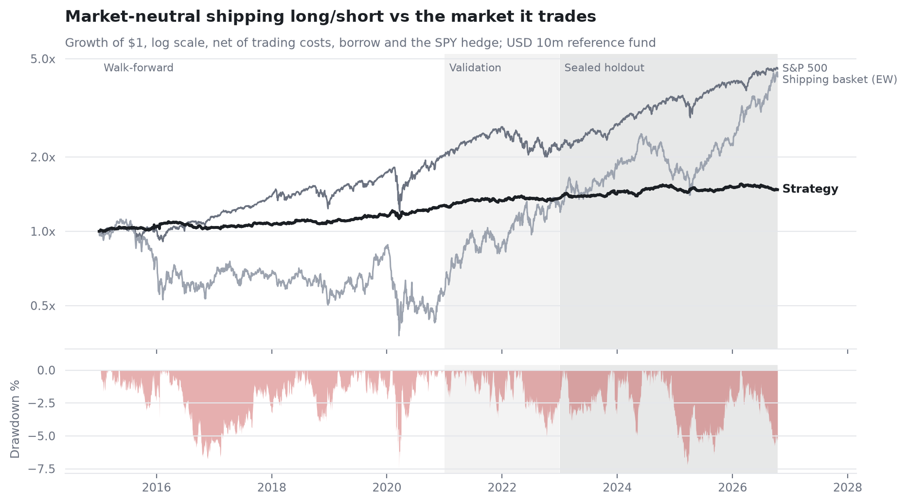

# Shipping Long/Short Lab

*Five linked research and data projects · Prepared 5 November 2026*

## The research question

How quickly is public shipping information priced, and where might slower information remain?

## Approach

A point-in-time universe, rebuilt total returns, walk-forward stock selection and logged trials lead into freight tests, ship-level tracking and filings analysis. Pre-registration, borrow and capacity assumptions are explicit. Five component pages explain the research chain.

## Evidence and result

The 2023-October 2026 holdout reports a 0.42 Sharpe and approximately zero beta. The deflated-Sharpe probability is 0.31 after 27 trials, so the result is not statistically persuasive after accounting for the search. Filings booking surprise remains exploratory.

*Research backtest; see the paper for costs and sample dates.*

## Scope and limitations

The freight and selection results do not establish investable alpha. FleetWatch’s first scored season is Q4 2026. Filings IC 0.26 / t 2.2 over 66 events needs event dependence and selection scrutiny. Local code is behind an actively updated remote. The local research checkout and public default branch may differ; match the version to the stated results.

## Explore the project

Read paper/research_note.pdf and docs/PREREGISTRATION.md. Show the dated live map separately from historical research; tests require the dev environment.

## Sources and evidence

[docs/PREREGISTRATION.md](../docs/PREREGISTRATION.md) · [docs/PREREGISTRATION_FILINGS.md](../docs/PREREGISTRATION_FILINGS.md) · [data/results/filings_summary.json](../data/results/filings_summary.json)

---

Hrush Ambekar · Research snapshot reviewed 5 November 2026. See linked source files for full methodology, figures and reproducibility.
